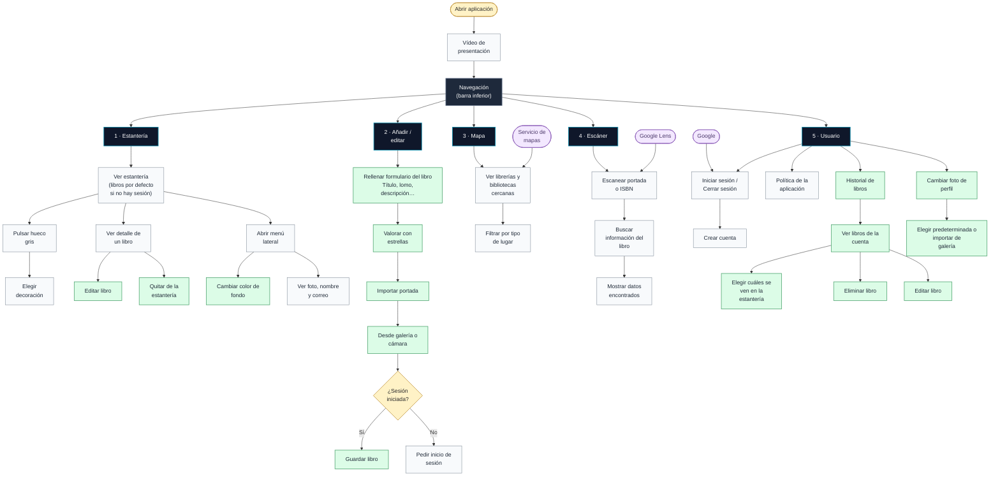

# Nook-Ink
Proyecto Final de Programación Multimedia y Dispositivos Móviles (DAM): desarrollo de una aplicación Android de biblioteca personal interactiva con Kotlin y Jetpack Compose.

## Prototipo de pantallas

## Diagrama de Flujo

## Diagrama de casos

  

